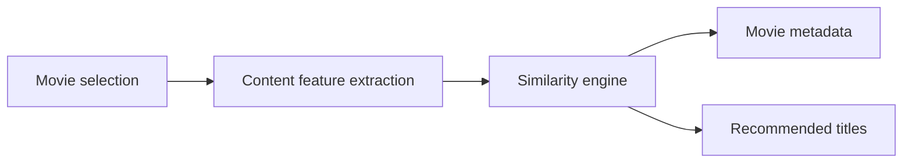

# 🎬 Movie Recommendation System using Machine Learning

## Project contribution

Demonstrates an accessible content-based recommendation workflow that converts movie metadata into relevant viewing suggestions.

## Architecture



A content-based movie recommendation system that suggests similar movies based on user input using machine learning techniques.

---

## 🧠 Overview

This project recommends movies similar to the one the user inputs. It uses content-based filtering and machine learning techniques (like cosine similarity on text vectors). The system is built using Python and includes:

- A **Jupyter Notebook** for data exploration and model training
- Python scripts (`app.py`, `main.py`) for backend logic
- A **frontend** (HTML/CSS/JS) interface (inside `frontend.zip`)
- A CSV dataset containing movie metadata

---

## 📁 Project Structure

movie-recommendation-system

│

├── Movie_Recommendation_System.ipynb # Main notebook with code and output

├── app.py # Web app backend (e.g., Flask)

├── main.py # Core logic for recommendations

├── movie recommendation system dataset.csv # Dataset used

├── frontend.zip # Frontend code (HTML/CSS/JS)

├── README.md # You're here


---

## 📦 Features

- 🧾 Takes movie name as input and recommends similar titles
- 🔍 Uses NLP techniques (TF-IDF / CountVectorizer)
- 🧠 Computes cosine similarity for recommendation
- 💻 Web interface for interactive usage (Flask + HTML/CSS)

---

## 🚀 Getting Started

### 1. Clone the Repository

```bash
git clone https://github.com/AryaLolusare2712/movie-recommendation-system.git
cd movie-recommendation-system
```

---

### 2. Install Dependencies

```bash
pip install -r requirements.txt
```

If requirements.txt is not present, install manually:

```bash
pip install pandas numpy scikit-learn flask
```

---

### 3. Run the App
Unzip the frontend folder:

```bash
unzip frontend.zip
```

Then start the Flask backend:

```bash
python app.py
```

Visit http://127.0.0.1:5000 in your browser.
